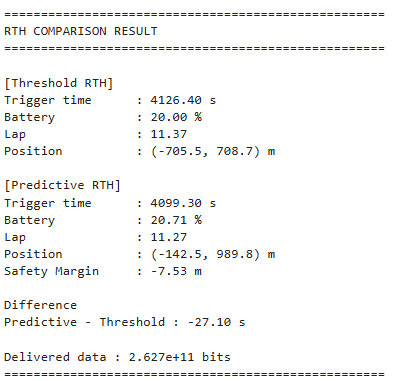

# 시뮬레이션과 결과 해석

[프로젝트 개요](README.md)

## 비교 절차

1. 시간 슬롯별 UAV 위치와 잔여 에너지를 갱신합니다.
2. 현재 에너지로 이동 가능한 최대 거리를 계산합니다.
3. 현재 위치에서 기지점까지의 거리를 계산합니다.
4. 배터리 20% 조건과 Safety Margin 조건을 각각 확인합니다.
5. 귀환 판단 시점, 배터리 잔량, 위치와 Lap을 비교합니다.

## 원본 출력

| 항목 | Threshold RTH | Predictive RTH |
| --- | --- | --- |
| Trigger time | 4126.40 s | 4099.30 s |
| Battery | 20.00% | 20.71% |
| Lap | 11.37 | 11.27 |
| Position | (-705.5, 708.7) m | (-142.5, 989.8) m |
| Safety Margin | 원본 출력에 미표기 | -7.53 m |

시점 차이는 `4099.30 - 4126.40 = -27.10 s`로, Predictive RTH가 27.10초 먼저 귀환을 판단했습니다.

## 결과 분석

Predictive RTH는 이 MATLAB 실행에서 배터리가 20%에 도달하기 전에 귀환을 판단했습니다. 위치와 잔여 에너지를 함께 고려하면 고정 배터리 임계값과 다른 시점에 귀환 조건이 성립합니다.

판단 시점의 Safety Margin은 -7.53 m로 기록됐습니다. 최대 이동 가능 거리와 기지점까지의 거리 차이가 0 이하로 내려가는 조건에서 귀환 판단이 발생한 결과입니다.

자료: 자기소개 발표자료 4~9쪽.
