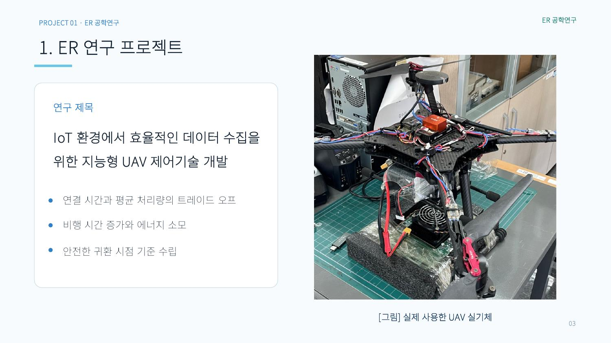

# UAV 장치와 시뮬레이션 그래프

[프로젝트 개요](README.md)

## 연구에 사용한 UAV

UAV 제어 연구 과정에서 사용한 기체입니다.

## 거리 비교

발표자료 8쪽. 에너지 감소와 경로 변화에 따른 두 거리의 변화를 보여줍니다.

## Safety Margin

발표자료 9쪽. 점선은 귀환 판단 시점과 연구에서 정의한 경계를 표시합니다.

## 실행 결과

발표자료 9쪽. 정량 수치의 기준으로 사용한 출력 화면입니다.
