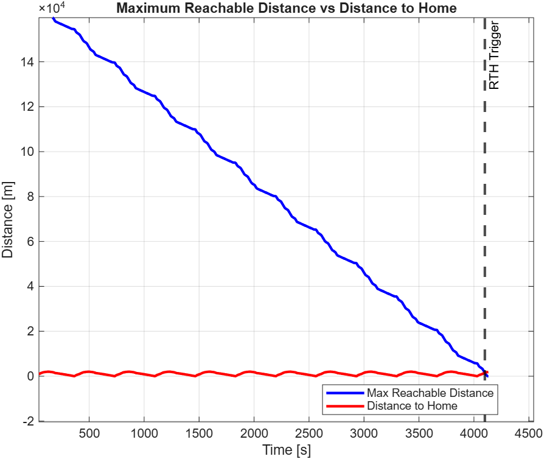
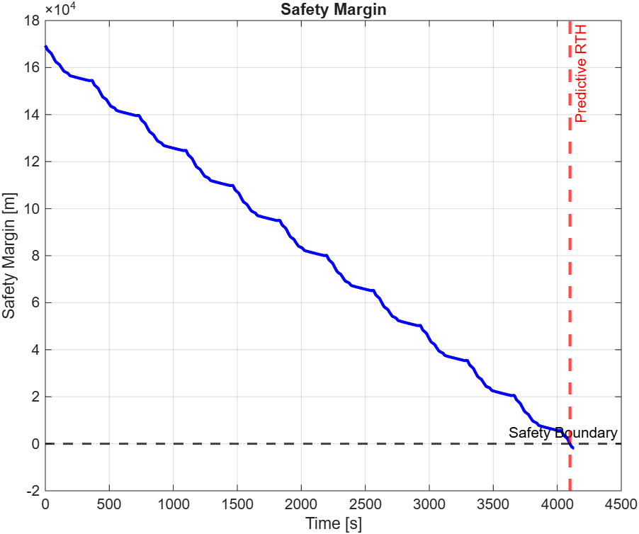

# UAV Predictive RTH | 위치와 에너지를 고려한 귀환 판단

배터리 비율만으로 귀환하는 방식의 한계를 분석하고, 잔여 에너지로 이동 가능한 거리와 기지점까지의 거리를 비교하는 Predictive RTH를 구현했습니다. MATLAB 타임 슬롯 시뮬레이션으로 판단 시점의 차이를 확인했습니다.

**담당 역할:** Threshold RTH 한계 분석, Predictive RTH 구현, MATLAB 비교 실험과 결과 시각화.

[실험과 결과 해석](EXPERIMENT.md) | [장치 및 시뮬레이션 그래프](GALLERY.md)



*발표자료에 수록된 실제 시뮬레이션 출력. 파란선은 최대 이동 가능 거리, 빨간선은 기지점까지의 거리입니다.*

## 연구 배경

연구 주제는 IoT 환경에서 효율적인 데이터 수집을 위한 지능형 UAV 제어입니다. 비행 시간을 늘리면 데이터 수집 기회가 늘지만 에너지가 소모됩니다. 같은 배터리 잔량이어도 기지점까지의 거리가 다르므로, 위치를 고려하지 않는 고정 임계값은 조기 귀환이나 귀환 판단 지연으로 이어질 수 있습니다.

## 판단 방식

| 방식 | 귀환 조건 |
| --- | --- |
| Threshold RTH | 배터리 잔량 ≤ 20% |
| Predictive RTH | 최대 이동 가능 거리 ≤ 기지점까지의 거리 |

연구에서 정의한 지표는 다음과 같습니다.

```text
Safety Margin = 최대 이동 가능 거리 - 기지점까지의 거리
```

각 시간 슬롯에서 위치와 에너지를 갱신하고 두 거리의 관계를 확인합니다. 원형 궤적을 따라 기지점까지의 거리가 변하므로 Safety Margin에도 주기적인 변화가 나타납니다.

## 비교 결과

| 항목 | Threshold RTH | Predictive RTH |
| --- | ---: | ---: |
| 귀환 판단 시점 | 4126.40 s | 4099.30 s |
| 판단 시 배터리 잔량 | 20.00% | 20.71% |
| Lap | 11.37 | 11.27 |

해당 실행에서는 Predictive RTH가 **27.10초 먼저** 귀환을 판단했습니다. 이 결과는 위치와 에너지 조건이 판단 시점을 바꾼다는 것을 보여줍니다.



## 수행 환경

| 도구 | 수행 내용 |
| --- | --- |
| MATLAB | 에너지 모델과 귀환 조건 분석, 비교 시뮬레이션 |
| ROS 2 / Gazebo | UAV 제어 로직의 가상환경 시험 |
| RViz | 위치 및 경로 시각화 |
| QGroundControl | 실제 UAV 조작과 경로 테스트 |

귀환 판단 비교는 MATLAB 시뮬레이션에서 수행했습니다. UAV 연구 과정에서는 ROS 2, Gazebo, RViz와 QGroundControl을 활용해 가상환경 시험과 기체 조작도 경험했습니다.

---

[← 김조은 포트폴리오](https://github.com/eunzobu/eunzobu)
